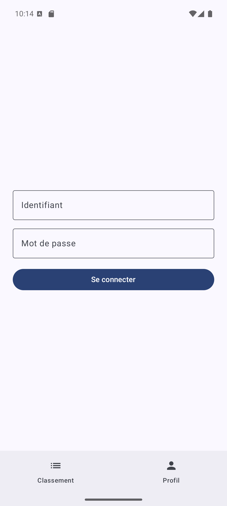
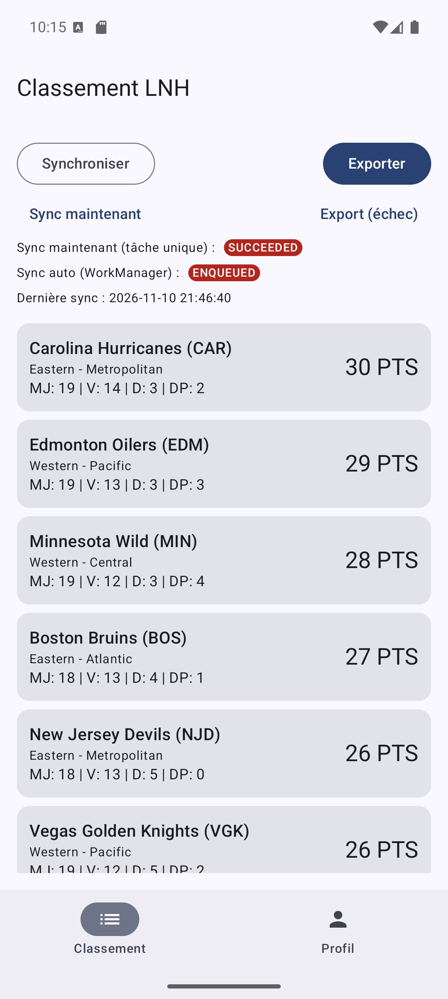
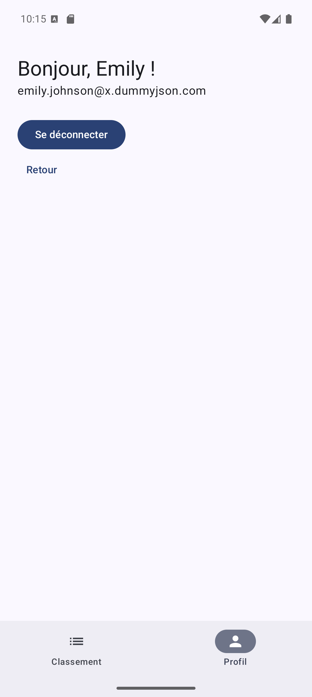
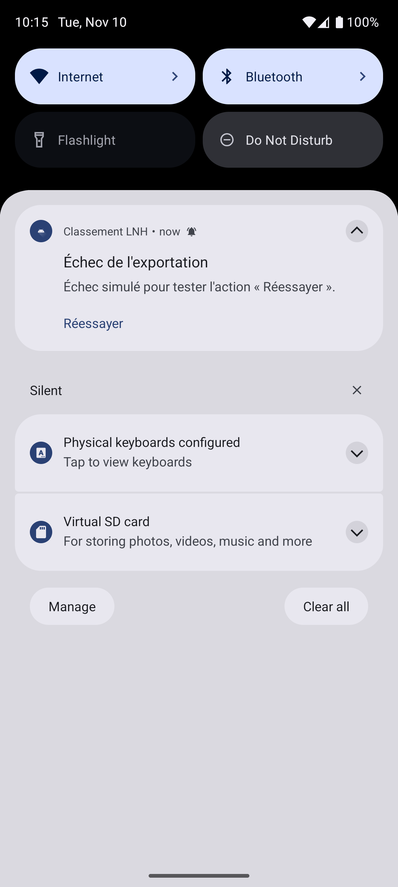

# 🏒 Classement LNH — Android

Application Android native (Kotlin + Jetpack Compose) qui affiche le **classement de la Ligue nationale de hockey**, le garde à jour en arrière-plan, l'exporte en JSON et notifie l'utilisateur des changements. Elle intègre aussi une **authentification par jeton** et la réception de **notifications push** Firebase.

> Projet réalisé dans le cadre du cours **420-5C4-ST – Développement mobile avancé** (Cégep Saint-Jean-sur-Richelieu), exercices 4 et 5.
> L'énoncé complet de l'exercice 5 se trouve dans [`app/readme.md`](app/readme.md).

<p align="center">
  
  
  
  
</p>

---

## Sommaire

- [Fonctionnalités](#fonctionnalités)
- [Stack technique](#stack-technique)
- [Architecture](#architecture)
- [Prérequis](#prérequis)
- [Installation](#installation)
- [Configuration Firebase](#configuration-firebase)
- [Utilisation](#utilisation)
- [Notifications](#notifications)
- [Scénarios de test](#scénarios-de-test)
- [APIs utilisées](#apis-utilisées)

---

## Fonctionnalités

### Classement et synchronisation
- Affichage du classement LNH (points, matchs joués, victoires, défaites, défaites en prolongation).
- **Cache local Room** : l'application reste utilisable hors ligne avec les dernières données enregistrées.
- **Synchronisation périodique** toutes les 4 h avec **WorkManager** (contrainte réseau, nouvelles tentatives en cas d'échec).
- **Détection des changements** : après chaque synchronisation, le Worker compare le classement avant/après et notifie le nombre d'équipes déplacées et la nouvelle équipe en tête, s'il y a lieu.

### Exportation
- Exportation du classement en **JSON** dans le dossier `Download` par un **service au premier plan** (*foreground service*) avec notification de progression.
- Notification de résultat :
  - succès → action **« Ouvrir le fichier »**;
  - échec → action **« Réessayer »** qui relance le service au moyen d'un `PendingIntent`.

### Authentification
- Connexion par jeton auprès de [DummyJSON](https://dummyjson.com/docs/auth).
- Jeton conservé en mémoire dans un `SessionManager` (`StateFlow`).
- Un **intercepteur OkHttp** ajoute `Authorization: Bearer <jeton>` uniquement sur le client de l'API d'authentification : l'API de la LNH ne reçoit jamais le jeton.
- Gestion des erreurs : identifiants invalides, session expirée, réseau indisponible, erreur du serveur.
- Écran de profil (prénom, courriel) et déconnexion avec retour automatique à l'écran de connexion.

### Notifications push
- Réception de messages **Firebase Cloud Messaging** et affichage via le même `NotificationHelper` que les notifications locales.

---

## Stack technique

| Domaine | Technologie |
|---|---|
| Langage | Kotlin 2.4 |
| Interface | Jetpack Compose, Material 3, Navigation Compose (routes typées) |
| Architecture | MVVM : `ViewModel` + `StateFlow` + Repository |
| Réseau | Retrofit 3, OkHttp (intercepteur), Gson (API LNH), kotlinx.serialization (API d'authentification) |
| Persistance | Room (KSP) |
| Arrière-plan | WorkManager, service au premier plan (`dataSync`) |
| Notifications | `NotificationCompat`, canaux, `PendingIntent`, Firebase Cloud Messaging |
| Build | Android Gradle Plugin 9.4, catalogue de versions (`libs.versions.toml`) |

**SDK :** `minSdk 24` · `targetSdk 37` · `compileSdk 37`

---

## Architecture

```
app/src/main/java/cstjean/mobile2/classementlnh/
├── ClassementLnhApplication.kt   # Dépendances, création des canaux, planification du Worker
├── MainActivity.kt               # Permission POST_NOTIFICATIONS, jeton FCM
├── auth/                         # Authentification DummyJSON
│   ├── SessionManager.kt         #   Jeton en mémoire (StateFlow)
│   ├── AuthApiService.kt         #   POST auth/login, GET auth/me
│   ├── AuthInterceptor.kt        #   En-tête Authorization: Bearer
│   ├── AuthRetrofitInstance.kt   #   Client OkHttp + Retrofit dédiés
│   ├── dto/                      #   LoginRequestDto, LoginResponseDto, ProfilDto
│   └── repository/               #   ApiAuthRepository (traduction des erreurs)
├── business/                     # Modèles utilisés par les ViewModels
├── data/
│   ├── AuthModels.kt             # Profil + exceptions d'authentification
│   └── remote/                   # API LNH (Retrofit) et DTO
├── database/                     # Room : entités, DAO, mappers
├── repository/                   # ClassementRepository (sync distante + accès local)
├── service/
│   ├── ExportService.kt          # Service au premier plan d'exportation JSON
│   └── ClassementFirebaseMessagingService.kt
├── worker/SyncClassementWorker.kt
├── util/NotificationHelper.kt    # Canaux et construction de toutes les notifications
├── viewmodel/                    # ViewModels et UiStates
└── ui/                           # Écrans Compose et navigation
```

**Flux de données :**

```
API LNH ──► ClassementRepository ──► Room ──► Flow ──► ClassementViewModel ──► ClassementScreen
                   ▲
     SyncClassementWorker (WorkManager) ──► comparaison avant/après ──► NotificationHelper
```

---

## Prérequis

- **Android Studio** (version récente compatible AGP 9.4)
- **JDK 17** (le JBR fourni avec Android Studio convient)
- Un appareil ou un émulateur **Android 13+** recommandé, pour tester la permission de notification

---

## Installation

```bash
git clone https://github.com/X0vaH/ProjetClassementLNH-Android.git
cd ProjetClassementLNH-Android
```

1. Ouvrir le dossier dans Android Studio et laisser Gradle se synchroniser.
2. (Optionnel) Configurer Firebase, voir la section suivante.
3. Lancer la configuration **app** sur un émulateur ou un appareil.

En ligne de commande :

```bash
./gradlew :app:assembleDebug
```

L'APK est généré dans `app/build/outputs/apk/debug/app-debug.apk`.

---

## Configuration Firebase

Le plugin `com.google.gms.google-services` n'est appliqué **que si** `app/google-services.json` est présent. Le projet compile donc avec ou sans Firebase.

Pour utiliser votre propre projet Firebase :

1. Dans la [console Firebase](https://console.firebase.google.com/), ajouter une application Android avec le package **`cstjean.mobile2.classementlnh`**.
2. Télécharger `google-services.json` et le placer dans **`app/`**, avec exactement ce nom.
3. Synchroniser Gradle, puis lancer l'application et accepter la permission de notification.
4. Copier le jeton FCM affiché dans Logcat (filtre `FCM_TOKEN`).
5. Console Firebase → **Messaging** → *Créer une campagne* → *Messages Firebase Notifications* → **Envoyer un message de test** → coller le jeton → **Tester**.

> Avec l'application au premier plan, le message est affiché par `ClassementFirebaseMessagingService`. En arrière-plan, c'est Android qui l'affiche directement.

---

## Utilisation

### Compte de test (DummyJSON)

| Identifiant | Mot de passe |
|---|---|
| `emilys` | `emilyspass` |

### Boutons de l'écran Classement

| Bouton | Action |
|---|---|
| **Synchroniser** | Synchronisation immédiate depuis le ViewModel. Met Room à jour, **sans** comparaison ni notification. |
| **Exporter** | Lance le service d'exportation JSON. |
| **Sync maintenant** | *(test)* Lance le `SyncClassementWorker` comme tâche unique : synchronisation, comparaison, notification. |
| **Export (échec)** | *(test)* Force un échec d'exportation pour vérifier l'action « Réessayer ». |

Les badges affichent l'état WorkManager de la tâche périodique (**Sync auto**) et de la tâche unique (**Sync maintenant**).

---

## Notifications

| Canal | Importance | Contenu |
|---|---|---|
| **Exportation** | `DEFAULT` | Progression de l'export, résultat (« Ouvrir le fichier » / « Réessayer »). |
| **Classement** | `DEFAULT` | Équipes ayant changé de position, nouvelle équipe en tête. Toucher la notification ouvre l'application. |
| **Notifications push (Test Firebase)** | `DEFAULT` | Messages reçus de Firebase Cloud Messaging. |

Toutes les notifications passent par `NotificationHelper`, qui vérifie la permission `POST_NOTIFICATIONS` (Android 13+) et l'activation des notifications. Si elles sont refusées, rien ne s'affiche et aucune erreur n'est levée : le Worker ne peut pas demander la permission et ne doit pas échouer pour autant.

---

## Scénarios de test

| Scénario | Étapes | Résultat attendu |
|---|---|---|
| Sync **avec** changement | Database Inspector → table `classement` → mettre `points = 999` à une équipe **du milieu du classement** → **Sync maintenant** | Notification « Classement LNH mis à jour » |
| Sync **sans** changement | **Sync maintenant** une 2ᵉ fois | Aucune notification |
| Notifications désactivées | Paramètres → Applications → Classement LNH → Notifications : désactiver → **Sync maintenant** | Aucun plantage, Worker `SUCCEEDED` |
| Échec d'exportation | **Export (échec)** → « Réessayer » dans la notification | Nouvelle exportation réussie |
| Connexion réussie | `emilys` / `emilyspass` | Accès au classement, profil d'Emily |
| Connexion refusée | Mauvais mot de passe | « Identifiant ou mot de passe incorrect » |
| Connexion sans réseau | Mode avion | « Réseau indisponible » |
| Push Firebase | Message de test depuis la console | Notification sur le canal push |

> 💡 Mettre 999 points à l'équipe déjà en tête ne change aucune position, donc aucune notification n'est attendue. Le bouton **Synchroniser** efface la modification sans notifier : utilisez **Sync maintenant**.

---

## APIs utilisées

| API | URL de base | Usage |
|---|---|---|
| NHL Web API | `https://api-web.nhle.com/v1/` | `GET standings/now` — classement actuel |
| DummyJSON | `https://dummyjson.com/` | `POST auth/login`, `GET auth/me` — authentification de démonstration |
| Firebase Cloud Messaging | — | Notifications push |

---

## Auteur

Projet scolaire réalisé par [@X0vaH](https://github.com/X0vaH) — Cégep Saint-Jean-sur-Richelieu, session printemps 2026.
